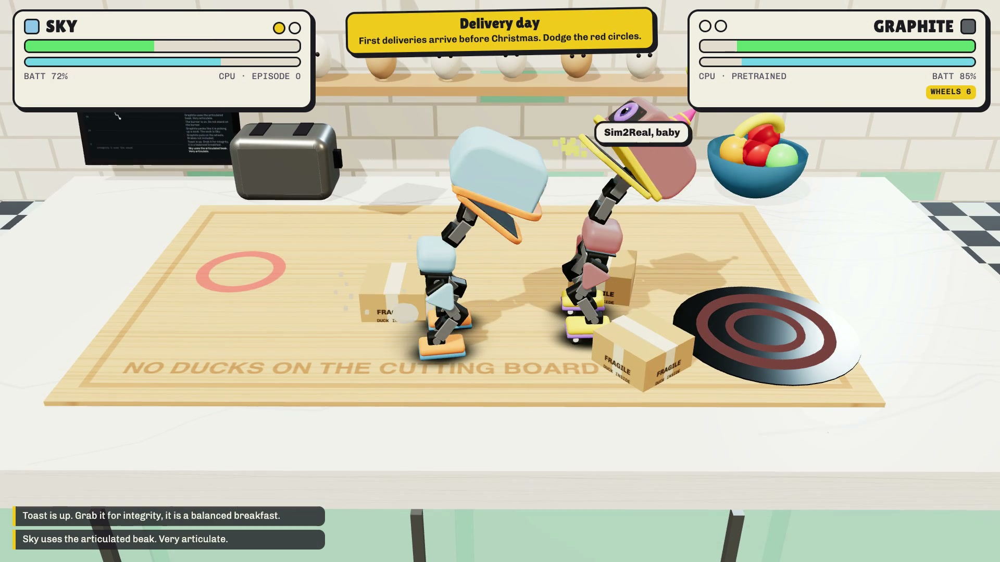
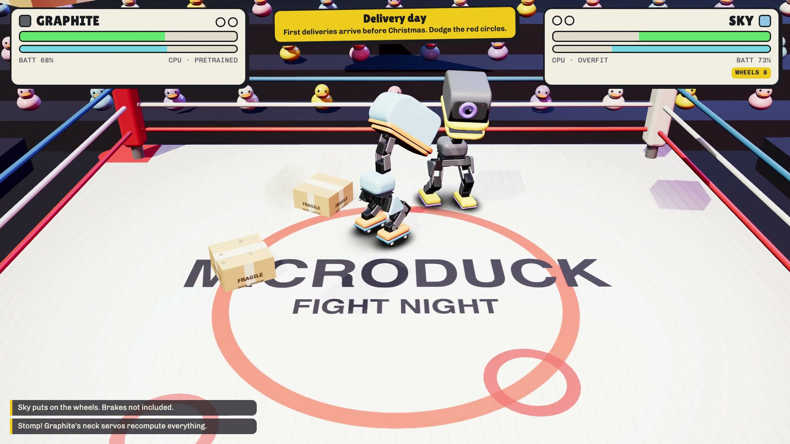

# 🦆 Microduck Fight

**[🕹️ Play Microduck Fight →](https://microduck-fight.andriil.chatgpt.site/)**

Tiny robot ducks. Big attitude. Absolutely no warranty coverage.

Battle the CPU, challenge a friend on one keyboard, or watch two CPUs settle their differences across 14 chaotic 3D arenas. Expect flying socks, slippery butter, and questionable duck decisions.

## Controls

| Key | Duck business |
| --- | --- |
| WASD / Arrow keys | Waddle |
| J / K / L | Peck / Headbutt / Skate dash |
| Space / Shift | Hop / Crouch |
| T | Unnecessary flip |
| P / M / N | Pause / Mute all / Toggle music |

Gamepads work too. See the in-game controls for two-player mode.

## Inside the pond

- `index.html` — game page and styles
- `js/` — game logic, duck models, sound, and arenas
- `img/` — item icons and arena thumbnails
- `tools/` — asset rendering and recording scripts

Built with JavaScript and Three.js. A fan-made game, unaffiliated with Hugging Face or Pollen Robotics. No real ducks were harmed. Their dignity is another matter.
